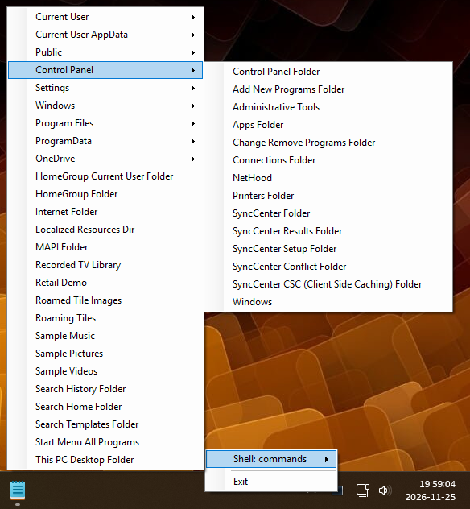

# QuickLauncher
QuickLauncher: a system tray launcher for Windows system folders (`shell:` commands), C# version

## Author

* [@remusrigo](https://github.com/RemusRigo)
* [@remusrigo](https://sourceforge.net/u/remusrigo/profile)

## Features

* Right-click the tray icon: open any of ~130 Windows `shell:` folders, grouped by category
* Left-click the tray icon: Rebuild missing folders (e.g. 3D Objects, Contacts, Camera Roll, Playlists)

## User's Guide

See the [User's Guide](Users%20Guide.md) for downloads, runtimes, installation and usage.

## Statistics

 

## Roadmap

* 2026-11-25: Add: Mutex so only one instance is running
* 2026-11-25: Fix: use %ProgramW6432% instead of %ProgramFiles%" in the x86 build
* 2026-11-25: Fix: Rebuild missing folders
* 2026-11-25: Fix: trayicon left/right mouse click
* 2026-03-19: Add: Rebuild missing folders
* 2026-03-19: Add: ICO: [Terminal](https://icon-icons.com/icon/terminal/11503) by Susumu Yoshida
* 2026-03-18: Project started (Based on the VB.NET version of QuickLauncher)
